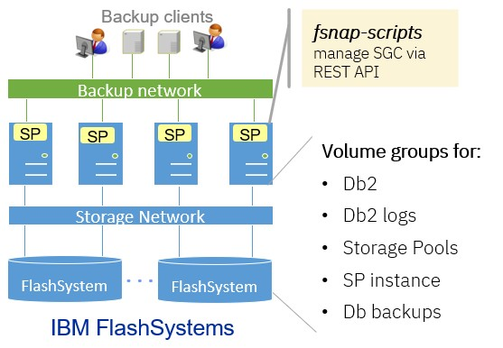

# Consistent SGC for IBM Storage Protect on IBM FlashSystem

-------------------------


## Important information when installing the new version

The following changes were published in August 2026 (version 1.9 / global functions 1.4–1.5):

| Change | Required action | Reason & benefit |
|--------|-----------------|------------------|
| `fsnap-create.sh` can now be launched from the **root crontab** using the new `-i instanceUser` flag | No config change required. Update cron entries if running from root — add `-i <instUser>` to the `fsnap-create.sh` call. See section [Scheduling with cron](#Scheduling-with-cron). | Simplifies scheduling on systems where only the root crontab is centrally managed. |
| **Structured logging engine** introduced in `fsnapfunctions.sh` | No action required. All scripts now emit timestamped, level-tagged log lines (`INFO`, `WARNING`, `ERROR`, `DEBUG`). Set `LOG_LEVEL=0` in the environment to enable `DEBUG` output. See section [Logging engine](#Logging-engine). | Consistent, filterable log output across all `fsnap` scripts. |
| `fsnap-list.sh` output is now a **dynamic-width aligned table** with a dedicated `SGC` column | No action required. Scripts or tools that parse `fsnap-list.sh` output by column position should be updated to use the new column headers. See section [List safeguarded copy](#List-safeguarded-copy). | Improved readability; `SGC` column clearly indicates safeguarded status (`true`/`false`). |
| Db2 logging during `fsnap-create` | Requires the tools `mktemp` and `mkfifo`. On Linux these tools are usually installed in `/usr/bin`. On AIX these tools can be installed from the Linux Toolbox. The tools must be accessible by the instance user (install the tools in `/usr/bin`) | direct and consistent logging of interactions with db2 |


The following changes were published in June 2026 and require actions when upgrading the `fsnap` scripts.

| Change | Required action | Reason & benefit |
|--------|-----------------|------------------|
| Added `$sudoCmd` for `/usr/bin/du` and `/usr/bin/df` commands in `fsnap-fscap.sh` and `fsnap-restore.sh` | add `/usr/bin/du, /usr/bin/df` to the sudoer-file for the SP instance user. See section [Adjust sudo-configuration](#Adjust-sudo-configuration). | Allow running `fsnap-fscap.sh` and `fsnap-restore.sh` as instance user |
| Removed reference to config parameter `consistentSnap` | Update configuration file `fsnapconfig.json` and remove parameter `consistentSnap` when it exists. | SGC with Storage Protect must be consistent. |


## Introduction

This project provides scripts (Unix bash) that facilitate the creation and restoration of consistent safeguarded copies (SGC) for IBM Storage Protect server instance storing their data in IBM FlashSystems. These scripts use the FlashSystem REST API to manage snapshots. 

The project also facilitates the creation and restoration of non-consistent SGC for volume groups that do not belong to a Storage Protect instance. Non-consistent means that there is no interaction with the Storage Protect instance database. Non-consistent SGC rely on a configuration parameter further explained in section [Configuration for non-consistent SGC](#Configuration-for-non-consistent-SGC). **Non-consistent SGC must not be used for FlashSystem volume group that belong to a Storage Protect instance.**


### License

This project is under [Apache License 2.0](../../LICENSE).


-------------------------------

## Architecture

The picture below shows the architecture of one or more Storage Protect instance using FlashSystem as data storage, whereby consistent SGC are managed by the `fsnap-scripts`. 




One or more Storage Protect instances use one or more FlashSystems to store data and metadata. A Storage Protect instance stores data (backup objects) and metadata (Db, active logs, archive logs, instance files and Db backup) in file systems on the server. The file systems are created on volumes provided by one or more FlashSystems. Volumes used by the Storage Protect instance must be assigned to volume groups in the respective FlashSystem. 

Each Storage Protect instance uses its own set of FlashSystem volume groups. Each FlashSystem volume group contains volumes that are mapped to file systems on the Storage Protect server. These file systems are used by one Storage Protect instances. The number of volume groups for each Storage Protect can be selected. Typically, there is one volume group for volumes used for metadata (Db, Logs, instance files, Db backup) and one volume group used for storage pool volumes. Names of volume groups and file system mount points are specified in the configuration file. 

The `fsnap-scripts` are executed on the Storage Protect server for the Storage Protect instance running on that server. The `fsnap-script` manage safeguarded copies through the REST API provided by the FlashSystem. 


Find below a guidance for planning, installation and configuration as well as a reference for all scripts. 


### Requirements and Limitations

Find below some limitations for the usage of these scripts with IBM FlashSystem:

Operating system support matrix: 

| Operating System | OS version | FlashSystem version | Storage Protect version |
|------------------|------------|-----------------------|-----------------------|
| Red Hat Enterprise Linux (RHEL) | 8 and 9 | 8.7 and 9.1 | 8.1.25 - 8.2 |
| AIX              | 7 TL 3     | 8.7 and 9.1 | 8.1.25 - 8.2 |


**Required software:**

See section [Operating system specific tools](#Operating-system-specific-tools) for a complete list of required software.


**Other requiremements and limitations:**

- One Storage Protect instance can use multiple FlashSystems to store backup data and metadata.
- Storage Protect disk, file and container pools are supported
- Volume reuse delay for Storage Protect storage pools must be set to the retention period of the snapshots plus 1. This especially applies to storage pools that are not snapped, for example copy pools on tape or cloud
- SGC are space efficient upon creation and consume additional storage capacity afterwards. This additional storage capacity must be sized and planned. See section [FlashSystem capacity planning for SGC](#FlashSystem-capacity-planning-for-SGC) for more guidance for storage capacity planning.
- FlashSystem volumes with Hyperswap enabled are supported. For the restoration of SGC, the Hyperswap relation must be removed manually. After restoration of SGC the Hyperswap relation can be recreated.
- FlashSystem volume groups with Policy Based High Availability enabled (PBHA, Version 8.7 and above) are supported. Restoration of SGC works without additional actions.
- FlashSystem volumes with Metro- or Global mirror enabled are not supported (not tested). 
- Supported file system types on the Storage Protect server are: logical volume manager (LVM) and xfs for Linux and JFS2 for AIX


### Known issues and observations

This section describes known issues and observations:

| Issue | Mitigation |
|-------|------------|
| When creating consistent SGC using an external scheduler, there is no message in the activity log of the Storage Protect server. | This is normal. If messages in the activity log are desired, then consider scheduling the creation of consistent SGC using the Storage Protect scheduler as described in section [ Scheduling with Storage Protect client schedules](#Scheduling-with-Storage-Protect-client-schedules) |
| The creating of consistent SGC during Storage Protect database backup fails. | This is because both operations cannot be run simultaneously. Define schedules where Storage Protect database backup and creation of SGC to not overlap |
| Backup client workload can be slowed down during SGC creation. This is because the Storage Protect database is suspended when SGC are created. During this time period (some seconds) client workloads are halted. After resuming the database database transaction resume and can cause intermediate workload increase on FlashSystems | Schedule the the SGC creation during times with lower backup client workloads. |
| Storage Protect server error ANR9999D occurs intermittently when creating SGC | There is no mitigation. This issue is related to the `servermon` process that collects statistics from the Storage Protect database. If the database is suspended because a snapshot is created, then the statistic cannot be collected and the ANR9999D occurs. A typical entry in the activity log may look like this: `ANR9999D_2395808121 dbiDbSpaceStats(rdbdb.c:3806) Thread<294>: Unexpected rc 1114 from RdbExecuteSQLToStrings.` |
| Restore of SGC fails | Examine the message on the console and solve the problem. Re-run the restore script with parameter `autoRestore` set to `false` in the configuration file. The restore script can be re-run at any time |
| In a Storage Protect environment with node replication, the restore of consistent SGC can cause subsequent replication errors. | After restoring consistent SGC on the primary SP server, disable replication while in maintenance mode (`disable replication`). Afterwards perform the procedure to [Replicating client node data after a database restore](https://www.ibm.com/docs/en/storage-protect/8.2.1?topic=replication-replicating-client-node-data-after-database-restore) to re-synchronize the source and the target server. |


------------------------------

## Planning and preparation

This section describes the planning and prerequisites for the installation and configuration of the `fsnap-scripts` including the configuration of the FlashSystem and the file systems and preparation of the the Storage Protect instances.


### FlashSystem capacity planning for SGC

IBM FlashSystem SGC are space efficient upon create and start consuming storage capacity upon changes of files in the file system. Depending on the Storage Protect internal workloads (for example, database, logs, storage pool) the storage capacity consumption in SGC can grow significantly. For this reason it is important to plan the storage capacity of the FlashSystem SGC accordingly.

The storage capacity consumption of SGC is influenced by
- number of SGC created per day
- SGC retention time - how long SGC are retained
- Storage Protect database backup schedule


The table below provides an estimate of the storage capacity consumption for FlashSystem SGC in accordance with the internal and backup workloads for one Storage Protect instance:

| SP workload | Estimated SGC capacity relative to life data | Note |
|-------------|---------------------------------------------------|------|
| Database | 50 - 100% per SGC | Depends on backup and internal activities |
| Active log | 80 - 100% per SGC | Full active logs are moved to archive logs |
| Archive log  | 50 - 100% per day | Assuming daily Db backup. Archive logs are deleted after Db backup  |
| Storage pools | 20% per day | Assuming 20% daily change rate |
| Db backup | 20% per day | Assuming daily Db backup with 5 days retention |
| Instance home | 50% per SGC | Db2 diag logs can cause larger consumption |


Life data is the capacity allocated (or planned) in the file system without SGCs. For example, if a SGC allocates 50% of a 1 TB file system, then the SGC allocates 0,5 TB. When 5 SGCs are retained, then 2,5 TB (5 x 0,5TB) of additional storage capacity must be planned. 


The next table gives two example about storage capacity consumption for SGCs for a medium-size Storage Protect instance. In the first example two SGCs are created per day and kept over 5 days. In the second example one SGC is created per day and kept over 10 days. This calculation assumes daily Db backup. 

| Workload | Storage capacity for life data | Estimated per SGC capacity | Extra capacity with 2 SGCs per day and 5 days retention |	Extra capacity with 1 SGCs per day and 10 days retention |
|----------|------------------|---------------------------------|--------------------------------------------------------------|----------------------------------|
| Database	| 5 TB | 50 – 100 % per SGC | 25 - 50 TB | 25 - 50 TB |
| Active logs | 147 GB | 80 – 100 % per SGC | 1176 - 1470 GB	| 1176 - 1470 GB |
| Archive logs | 2 TB | 50 – 100 % per day | 5 – 10 TB | 10 - 20 TB |
| Storage pools | 350 TB |20 % per day | 350 TB | 700 TB |
| Db backup |30 TB | 20 % per day | 30 TB | 60 TB |
| Instance home | 20 GB | 50 % per SGC | 100 GB | 100 GB |
| **Total capacity** | **287,2 TB** | -- | **411,3 - 441,6 TB** | **796,3 - 931,5 TB** |


As shown in the table above, the total number of SGCs is identical in both examples but the storage capacity consumption in the second example is almost twice as much because the SGCs are retained twice as long compared to the first example. 


### Operating system specific tools

The `fsnap-scripts` require the following tools to be installed in the operating system of the Storage Protect instance. These tools must be executable by all users executing the `fsnap-scripts` including the Storage Protect instance users. Preferably, these tools should be install in `/usr/bin`. 

- bash:     Shell (all scripts are written in bash), should be installed in `/usr/bin`. The Storage Protect instance users should have the bash shell as login shell. 
- fsfreeze: freeze and unfreeze file system **on Linux**, should be installed in `/usr/sbin`
- sync:     synchronize file systems on disk. **On Linux** it should be installed in `/usr/bin`. **On AIX** it should be installed on `/usr/sbin`. 
- chfs:     freeze and unfreeze file system **on AIX**, should be installed in `/usr/sbin`
- jq:       JSON parser, should be installed in `/usr/bin`. **For AIX** the `jq` tool comes from the Linux toolbox. It is recommended to link `jq` to /usr/bin (for example: `ln -s ln -s /opt/freeware/bin/jq /usr/bin/`)
- curl:     interact with REST API, should be installed in `/usr/bin`. **For AIX** the `curl` tool comes from the Linux toolbox. It is recommended to link `curl` to /usr/bin (for example: `ln -s ln -s /opt/freeware/bin/curl /usr/bin/`)
- awk:      parse text, should be installed in `/usr/bin`
- ksh93:    calculating dates **on AIX**, should be installed in `/usr/bin`
- base64:   decoding API credentials, should be installed in `/usr/bin`. **On AIX** this tool comes with the `coreutils` package from the AIX Linux Toolbox and should be linked in `/usr/bin`. 
- mktemp:   create temporary directory. **On AIX** this tool comes with the `coreutils` package from the AIX Linux Toolbox and should be linked in `/usr/bin`. 
- mkfifo:   creates named pipes for db2 logging. **On AIX** this tool comes with the `coreutils` package from the AIX Linux Toolbox and should be linked in `/usr/bin`.


The instance user must be configured to use `bash` as initial program shell. This is particularly important **for AIX**, where the default shell is `ksh`. The `ksh` shell causes the instance home directory to be busy during restore. To set the instance user shell to `/usr/bin/bash` in AIX, first enable `/usr/bin/bash` in `/etc/security/login.cfg` and than set the shell in the user configuration. 

Make sure that the instance user can execute the commands above, for example by adding the appropriate `PATH` to the profile (`.profile). 


### FlashSystem

All volumes used by one Storage Protect instance must be assigned to one or more FlashSystem volume groups. These FlashSystem volume groups must not be used for volumes of other Storage Protect instance. In other words, one FlashSystem volume group must only contain volumes used by one Storage Protect instance. The names of the FlashSystem volume groups are required when configuring the solution (see section [Adjust configuration files](#Adjust-configuration-files)).

The volume groups for one instance can be provided by multiple FlashSystems. See section [Filesystems](#Filesystems) for more details about the FlashSystem volume, volume group and file system configuration .


**Note:** The operating system disk must not be included in any FlashSystem volume group that is used by the Storage Protect instance. The operating system disk can be included in other FlashSystem volume groups that are not snapped. 


A REST API user in user group `CopyOperator` or `Adminstrator` must be created on each FlashSystem to facilitate the SGC management provided by the `fsnap-scripts`. For creating, listing and deleting SGC a API user with minimum role of `CopyOperator` is required. For the restoration of SGC an API user with minimum role of `Administrator` is required.

Collect the following information for the REST API for each FlashSystem:
- IP address or IP alias
- IP port
- REST API user name in the `CopyOperator` or `Administrator` role
- REST API user password

The REST API user name and password must be encoded in base64. The resulting encoded credentail can either be provided as configuration parameter `apiCredential` in the configuration file or as environment variable `apiCredential_Arr`. See section [Providing apiCredential as environment variable](#Providing-apiCredential-as-environment-variable) for more details. 

To encode the user name and password in base64, use the following command whereby username is the REST API user in the appropriate role and password is the password of the user. Note, character `:` cannot be used in user or password strings:

```
# echo username:password | base64
```

Collect the resulting string and assign it to parameter `apiCredential` in the configuration file or use it as environment variable `apiCredential_Arr`. 


### Filesystems

File system must be created on volumes provided by the FlashSystems in volume groups. The mount points of the file systems are required when configuring the solution (see section [Adjust configuration files](#Adjust-configuration-files)).

Find below an example of the FlashSystem volume groups, volumes, file systems and usage:

| Volume group | Volumes | Filesystem mount point | Usage |
|--------------|---------|------------------------|-------|
|isp_inst01_db |isp_inst01_db01 |/tsm/inst01/tsmdb01 |database file system |
|	|isp_inst01_db01 |/tsm/inst01/tsmdb02 | database file system |
|	|isp_inst01_db02 |/tsm/inst01/tsmdb03 | database file system |
|	|isp_inst01_db03 |/tsm/inst01/tsmdb04 | database file system |
|	|isp_inst01_actlog |/tsm/inst01/tsmactlog | active log file system |
|	|isp_inst01_archlog |/tsm/inst01/tsmarchlog | archive log file system |
|	|isp_inst01_dbbackup |/tsm/inst01/tsmdbbackup | database backup file system |
|	|isp_inst01_instance |/tsm/inst01/tsminst | instance file system |
|	|	|	|	|
|isp_inst01_stg |/tsm/inst01/tsmstg01 | storage pool file system |
|	|isp_inst01_stgp02 |/tsm/inst01/tsmstg02 | storage pool file system |
|	|isp_inst01_stgp03 |/tsm/inst01/tsmstg03 | storage pool file system |
|	|isp_inst01_stgp04 |/tsm/inst01/tsmstg04 | storage pool file system |
|	|isp_inst01_stgp05 |/tsm/inst01/tsmstg05 | storage pool file system |


### Storage Protect instance and network

The Storage Protect instance must be setup using the file systems configured on volumes on FlashSystem volume groups. The Storage Protect instances must be free of errors. 

Volume reuse delay for Storage Protect storage pools must be set to the retention period of the SGC (add one day for safety margin). This especially applies to storage pools that are not snapped, for example copy pools on tape or cloud. 

The Storage Protect server must have network connection to the FlashSystem REST API service. The FlashSystem REST API port `7443` must be enabled in the firewall for the network between the Storage Protect server and the FlashSystem.

The Storage Protect instance user should use bash shell (`/usr/bin/bash`) as login shell, and not korn shell (`/usr/bin/ksh`). Korn shell causes the instance user file directories to be busy, even if the user stepped out of the instance user directory. When using AIX as operating system, then the bash-shell might have to be added to trusted shells in file `/etc/security/login.cfg` under the parameter `shells =`.


### Adjust sudo-configuration

The creation (`fsnap-create.sh`) and restoration (`fsnap-restore.sh`) of SGC must be executed by the Storage Protect instance user because it requires interaction with the Storage Protect Db2 database. The associated scripts perform mount, unmount, freeze and unfreeze operations for the relevant file systems. These operations must be allowed for the instance users by leveraging sudo-configuration. 

For **Linux** add the following entry to the sudo-configation, allowing the instance users the relevant operations via sudo:

```
### Allow all users in group tsmsrvrs to run SGC commands and mmsysmonc without password
%tsmsrvrs ALL=(ALL)       NOPASSWD: /usr/sbin/fsfreeze, /usr/bin/mount, /usr/bin/umount, /usr/bin/sync, /usr/bin/du, /usr/bin/df
```


For **AIX** add the following entry to the sudo-configation, allowing the instance users the relevant operations via sudo:

```
### Allow all users in group tsmsrvrs to run SGC commands and mmsysmonc without password
%tsmsrvrs ALL=(ALL)       NOPASSWD: /usr/sbin/chfs, /usr/sbin/mount, /usr/sbin/umount, /usr/sbin/sync, /usr/bin/du, /usr/bin/df
```


**Note:** The privilege for `fsfreeze` or `chfs` is required to create safeguarded copies executed by the `fsnap-create.sh` script. Since this script typically runs automatically this privilege is mandatory for the instance user. 

The privilege for `mount` and `umount` is required to restore safeguarded copies executed by the `fsnap-restore.sh` script. When running the restore in manual mode (configuration parameter `autoRestore=false`), then this privilege is not required for the instance user. However, during manual restore the privilege to `mount` and `unmount` must be provided by another user. 

The privilege for `du` is required by the `fsnap-fscap.sh` script to determine the storage capacity stored in the file systems. The privilege for `df` is required by the `fsnap-restore.sh` script to check if file systems are mounted or unmounted. 


If a different command than `/usr/bin/sudo` is used for privilege escalation, then the configuration parameter `sudoCommand` can be set to the command that is used in the configuration file `fsnapconfig.json` (see [Adjust configuration files](#Adjust-configuration-files)).


------------------------------

## Installation and configuration

This section describes the installation and configuration of the scripts associated with this project. 

For the installation and configuration of the `fsnap-scripts` root privileges are required. 

### Copy and explore scripts

Copy or git clone the scripts to the Storage Protect server (e.g. `/tmp/`):

```
# git clone https://github.ibm.com/IBM-Client-Engineering-EMEA/snap-protect.git /tmp/
# cd /tmp/snap-protect/flashsystem/
```

**Note:** The gitHub repository is only accessible by the IBM organization. If you obtained the scripts from IBM, then copy the scripts to the Storage Protect servers. 

The following files are included in this project:

| Filename | Description |
|----------|-------------|
| fsnap-create.sh  | Script creates SGC on FlashSystems |
| fsnap-delete.sh  | Script deletes SGC o FlashSystems. Only required for non-safeguarded snapshots |
| fsnap-fscap.sh   | Script prints file system and snapshot capacity allocation |
| fsnap-list.sh    | Script lists SGC for the SP instance |
| fsnap-restore.sh | Script restores SGC |
| fsnap-volstate.sh| Script prints volume status for all relevant volume groups |
| fsnap-wrapper.sh | Script wrapping the other `fsnap-scripts`, can be used with schedulers |
| fsnapfunctions.sh| Provides common functions and parameters for all `fsnap-scripts` |
| fsnapconfig.json | Configuration file describing the SP instance and FlashSystem connection |


The script files (`*.sh`) are further described in sectio [Workflows and scripts](#Workflows-and-scripts). The configuration file (`fsnapconfig.json`) is described in the next section [Adjust configuration files](#Adjust-configuration-files).


**Note:** Add the script path (e.g. `/usr/local/bin`) to the `$PATH` variable of the instance user.


### Copy files to common directory

The creation (`fsnap-create.sh`) and restoration (`fsnap-restore.sh`) of SGC must be executed by the Storage Protect instance user because it requires interaction with the Storage Protect Db2 database. For this reason, the scripts and configuration file of this project should be copied to a common directory and file permissions must be set to allow the Storage Protect instance user to execute these scripts. The recommended directory for the `fsnap`-scripts and configuration file is `/usr/local/bin`. 

Copy the `fsnap`-scripts and configuration files to a common directory such as `/usr/local/bin` and adjust the permissions for the instance user and instance user group by replacing `instUser` and `instUserGroup` with the user and group name of the instance user:

```
# cd /tmp/snap-protect/flashsystem/
# cp * /usr/local/bin/
# cd /usr/local/bin
# chmod +x fsnap-*.sh
# chown instUser:instUserGroup fsnap*
```

In this example the `fsnap-scripts` were copied to directory `/usr/local/bin` and the permissions are adjusted to `755` for instance user `tsminst1` in instance user group `tsmsrvrs`. The `fsnap-wrapper` script does not require permissions for the instance user `tsminst1` because it can be executed by root. Find below an example of the permission and ownership for the `fsnap-scripts`:

```
-rw-r--r--. 1 tsminst1 tsmsrvrs  fsnapconfig.json
-rwxr-xr-x. 1 tsminst1 tsmsrvrs  fsnap-create.sh
-rwxr-xr-x. 1 tsminst1 tsmsrvrs  fsnap-delete.sh
-rwxr-xr-x. 1 tsminst1 tsmsrvrs  fsnap-fscap.sh
-rw-r--r--. 1 tsminst1 tsmsrvrs  fsnapfunctions.sh
-rwxr-xr-x. 1 tsminst1 tsmsrvrs  fsnap-list.sh
-rwxr-xr-x. 1 tsminst1 tsmsrvrs  fsnap-restore.sh
-rwxr-xr-x. 1 tsminst1 tsmsrvrs  fsnap-volstate.sh
-rwxr-xr-x. 1 root     root      fsnap-wrapper.sh
```

**Note:** all scripts and the configuration file must reside in the same directory. The directory `/usr/local/bin` is recommended, but not mandatory. The scripts and configuration file can be in any directory accessible by the Storage Protect instance users. 

**Do not copy the files to the Storage Protect instance user home directory, because this directory will be overwritten upon restore.**


### Adjust configuration files

The configuration file `fsnapconfig.json` describes essential parameters for each Storage Protect instance. Find below a desription of these parameters:

| Parameter | Description | Required | Example |
|-----------|-------------|---------|---------|
| instName | Instance name, corresponds to the instance user | yes | tsminst1 |
| dbName | Name of the Db2, default is TSMDB1 | no | TSMDB1 | 
| snapPrefix | Prefix of the snapshot name. Each prefix is appended with a time stamp postfix. | yes | tsminst1 |
| snapRetention | Retention time in days for the snapshot, default is 1 days (0 days is not allowed). Snapshots cannot be deleted during retention time	| no | 5 |
| serverInstDir | Instance directory of the server (where dsmserv.opt resides). Must only be specified if different to instance user home. Default is instance user home directory.	| no | /tsminst/inst01/home |
| sudoCommand | Full qualified path of command used by the instance user run other commands with root privileges. Default is `/usr/bin/sudo`. | no | /usr/bin/dzdo |
| apiServerIP | IP address or host name of the FlashSystem REST API server. | yes | 10.10.10.10 |
| apiServerPort | IP port of the FlashSystem REST API server. | yes | 7443 |
| apiCredential | Base64 encoded user and password for FlashSystem REST API, for details see section [Planning and Preparation](#flashsystem). Parameter `apiCredential` is optional in the configuration file and can instead be provided as an environment variable `apiCredential_Arr` (see section [Providing apiCredential as environment variable](#Providing-apiCredential-as-environment-variable)) | no | xxxxx |
| autoRestore | Perform automatic (true) or manual (false) restore. When set to true, then the restore is performed automatically. Default value is false | no | true |
| safeGuarded | Create safe guarded copy (`true`) or not (`false`). Non-safeguarded copies can be used for testing. Default value is true | no | false |
| vgfsMapping | Maps the volume groups to file systems. `vgfsMapping` is an array where each array element includes one volume group name and one or more file system mount points that use volumes on this volume groups.  | yes | `"vgfsMapping": [ { "vgName": "vg-name", "fSystems": [ "fs-mount-1", "fs-mount-2" ] },` |
| vgfsMapping.vgName | Name of the volume group (single name). | yes | `"vgName": "vg-name"` |
| vgfsMapping.fSystems | An array of file system mount points that use the volumes provided in the volume group desribed in this element. | yes | `"fSystems": [ "fs-mount-1", "fs-mount-2" ]` |


Not all parameters are required, some are optional and have default values when not set. The required parameters must be adjusted in file `fsnapconfig.json`. Here is an example of the configuration file describing one Storage Protect instance configuration storing data and metadata on one FlashSystem. It includes two FlashSystem volume groups (parameter `vgfsMapping.vgName`) and the associated file systems (parameter `vgfsMapping.fSystems`):

```
{
  "instances":
  [
    {
      "instName": "tsminst1",
      "dbName": "TSMDB1",
      "snapPrefix": "tsminst1",
      "snapRetention": "10",
      "serverInstDir": "/tsminst/inst01/home",
      "sudoCommand": "/usr/bin/sudo", 
      "apiServerIP": "10.10.10.10",
      "apiServerPort": "7443",
      "apiCredential": "xxxxxxx", 
      "autoRestore": true,
      "safeGuarded": true,
      "vgfsMapping": [
        {
          "vgName": "isp_inst01_db",
          "fSystems": [ /tsm/inst01/tsminst", "/tsm/inst01/tsmactlog", "/tsm/inst01/tsmarchlog", "/tsm/inst01/tsmdb01", "/tsm/inst01/tsmdb02", "/tsm/inst01/tsmdb03", "/tsm/inst01/tsmdb04", "/tsm/inst01/tsmdbbackup" ]
        },
        {
          "vgName": "isp_inst01_stg",
          "fSystems": [  "/tsm/inst01/tsmstg01", "/tsm/inst01/tsmstg02", "/tsm/inst01/tsmstg03", "/tsm/inst01/tsmstg04", "/tsm/inst01/tsmstg05" ]
        }
      ]
    }
  ]
}
```

The recommended location of the configuration file `fsnapconfig.json` is in `/usr/local/bin`. The scripts and configuration file can be in any directory accessible by the Storage Protect instance users.

Adjust the configuration file `fsnapconfig.json` according to the environment and save it. This file must be readable by the Storage Protect instance user(s).  

One Storage Protect instance is described with one JSON object that start with parameter `instName` as shown above. The configuration file `fsnapconfig.json` can include multiple JSON objects for multiple Storage Protect instances and FlashSystems (see section [Configuration with multiple FlashSystems per instance](#Configuration-with-multiple-FlashSystems-per-instance)). 


#### Configuration with multiple FlashSystems per instance

When one Storage Protect instance uses multiple FlashSystems, then each FlashSystem is described in a separate JSON object, whereby the instance name `instName` is the same in all JSON objects describing this instance. Find below an example, where the Storage Protect instance `tsminst1` uses two FlashSystems and each FlashSystem holds one volume group. The first object describes the instance `tsminst1` on the FlashSystem-10 holding the volume group `isp_inst01_db` and the associated file systems. The second object describes the instance `tsminst1` on the FlashSystem-11 holding the volume group `isp_inst01_stg` and the associated file systems. 

```
{
  "instances":
  [
    {
      "instName": "tsminst1",
      "dbName": "TSMDB1",
      "snapPrefix": "tsminst1",
      "snapRetention": "10",
      "serverInstDir": "/tsminst/inst01/home",
      "sudoCommand": "/usr/bin/sudo", 
      "apiServerIP": "10.10.10.10",
      "apiServerPort": "7443",
      "apiCredential": "xxxxxxx", 
      "autoRestore": true,
      "safeGuarded": true, 
      "vgfsMapping": [
        {
          "vgName": "isp_inst01_db",
          "fSystems": [ /tsm/inst01/tsminst", "/tsm/inst01/tsmactlog", "/tsm/inst01/tsmarchlog", "/tsm/inst01/tsmdb01", "/tsm/inst01/tsmdb02", "/tsm/inst01/tsmdb03", "/tsm/inst01/tsmdb04", "/tsm/inst01/tsmdbbackup" ]
        }
      ]
    },
    {
      "instName": "tsminst1",
      "dbName": "TSMDB1",
      "snapPrefix": "tsminst1",
      "snapRetention": "10",
      "serverInstDir": "/tsminst/inst01/home",
      "sudoCommand": "/usr/bin/sudo", 
      "apiServerIP": "10.10.10.11",
      "apiServerPort": "7443",
      "apiCredential": "xxxxxxx", 
      "autoRestore": true,
      "safeGuarded": true, 
      "vgfsMapping": [
        {
          "vgName": "isp_inst01_stg",
          "fSystems": [  "/tsm/inst01/tsmstg01", "/tsm/inst01/tsmstg02", "/tsm/inst01/tsmstg03", "/tsm/inst01/tsmstg04", "/tsm/inst01/tsmstg05" ]
        }
      ]
    }
  ]     
}
```

The parameters `instName`, `dbName`, `serverInstDir`, `sudoCommand` and `autoRestore` must be set identical for all json objects that describe the configuration for one Storage Protect instance. 


#### Providing apiCredential as environment variable

The configuration parameter `apiCredential` contains the encoded FlashSystem user and password. To improve security, this parameter can be removed from the configuration file `fsnapconfig.json` and can instead be provided as environment variable `apiCredential_Arr`. The following example shows how to invoke the script `fsnap-list.sh` with the REST API credentials provided as environment variable:

```
# apiCredential_Arr="Zmxhc2gxOnBhc3N3b3JkMQo=" fsnap-list.sh 
```

If an Storage Protect instance uses multiple FlashSystems, then the environment variable `apiCredential_Arr` simply includes the credentials for each FlashSystem in the order they are listed in the configuration file `fsnapconfig.json`, separated by blank. The following example shows how to invoke the script `fsnap-list.sh` with the REST API credentials provided as environment variable for two FlashSystems:

```
# apiCredential_Arr="Zmxhc2gxOnBhc3N3b3JkMQo= Zmxhc2gyOnBhc3N3b3JkMgo=" fsnap-list.sh
```

If the API credentials are provided as environment variable `apiCredential_Arr`, then the configuration parameter `apiCredential` can be ommitted from the configuration file `fnapconfig.json`. If both, the environment variable `apiCredential_Arr` and the configuration file parameter `apiCredential` are specified, then the environment variable is used.


### Test scripts

To test scripts change to the instance user (for example `tsminst1`) and test the scripts:

```
# su - tsminst1
$ fsnap-list.sh
$ fsnap-create.sh --help
$ fsnap-restore.sh --help
```


### Create schedules

The creation and deletion of consistent SGC can be scheduled with different methods, such as system scheduler like `cron`, Storage Protect client schedules or external schedulers. The creation of SGC must be executed by the instance user (for example `tsminst1`), hence the schedule must be created in the context of the instance user. 

**Note:** Do not schedule the SGC creation at the same time when a Storage Protect Db backup is executed or during heavy backup or housekeeping workloads!!


#### Scheduling with cron

Schedules with `cron` must be defined on all servers where Storage Protect instances are running. Each Storage Protect can have its own schedule. This also requires that the `fsnap` scripts are installed on all servers hosting Storage Protect instances.

**Option A – instance user crontab (recommended)**

The example below creates an SGC every day at midnight using `fsnap-create.sh` (see [Create safeguarded copy](#Create-safeguarded-copy)). Adjust the setting of `home-directory-of-instance-user` for parameters `HOME` and `BASH_ENV`:

```
# su - tsminst1
$ crontab -e

SHELL=/bin/bash
HOME=[/home-directory-of-instance-user]
PATH=/sbin:/bin:/usr/sbin:/usr/bin:/usr/local/bin
BASH_ENV=[/home-directory-of-instance-user]/.profile
MAILTO=root

# create snapshot at midnight every day
00 00 *  *  * /usr/local/bin/fsnap-create.sh -r >> /tmp/snaplogs/tsminst1-snapcreate.log 2>&1
```

An alternative way to schedule the creation of SGC is to source the `profile` of the instance user prior to executing `fsnap-create.sh`:

```
# create snapshot at midnight every day
00 00 *  *  * . [/home-directory-of-instance-user]/.profile; /usr/local/bin/fsnap-create.sh -r >> /tmp/snaplogs/tsminst1-snapcreate.log 2>&1
```

**Option B – root crontab**

`fsnap-create.sh` can be executed directly from the root crontab by providing the `-i instanceUser` flag. The script detects that it is running as root, and automatically re-executes itself as the specified instance user via `sudo -u <instUser> bash --login`. This loads the instance user's login profile (including `db2profile`) so that `db2` and all other required tools are available.

Prerequisites for root crontab scheduling:
- `sudo` must allow root to run commands as the instance user without a password, for example: `root ALL=(tsminst1) NOPASSWD: ALL`
- The instance user (`-i` flag) must correspond to an entry in `fsnapconfig.json`

```
# root crontab  (crontab -e as root)

# create snapshot at midnight every day for instance tsminst1
00 00 * * * /usr/local/bin/fsnap-create.sh -r -i tsminst1 >> /tmp/snaplogs/tsminst1-snapcreate.log 2>&1
```

**Note:** When using the root crontab the `-i instanceUser` parameter is **required**. Without it, the script will fail because `root` is not a valid Storage Protect instance user.


Safeguarded copies are deleted automatically by the FlashSystem. Hence, the deletion of SGC must not be scheduled. If non-safeguarded copies are used for testing, then these can be deleted manually. Find below the example of a schedule for deleting SGC older than 10 days:

```
# delete snapshots older than 10 days at 00:00
15 00 * * * /usr/local/bin/fsnap-delete.sh -i tsminst1 -g 10 >> /tmp/snapdel/tsminst1-snapdel.log 2>&1
```

**Note:** the age of the snapshot given with the parameter `-g` must be equal or greater than the snapshot retention time given in configuration parameter `snapRetention`.


#### Scheduling with Storage Protect client schedules

The Storage Protect scheduler can be used to schedule the creation and deletion of consistent SGC. This requires two additional components on all servers running Storage Protect instances that are snapped:

- `fsnap-wrapper.sh` script that is invoked by the client schedule and runs the appropriate `fsnap` script (see [Wrapper script](#Wrapper-script)).
- Storage Protect client acceptor daemon `dsmcad`


On the server, install `fsnap-wrapper.sh` script in `/usr/local/bin`, or a different path that is accessible by the root user. Make the script executable:

```
chmod +x /usr/local/bin/fsnap-wrapper.sh
```

In the Storage Protect instance register client node for scheduling. The client node name in this example is `fsnap-scheduler`:

```
> REGISTER NODE fsnap-SCHEDULER ?***? USERID=NONE DOMAIN=STANDARD EMAILADDRESS=admin@my-company.org CONTACT=admin-name
```


In the Storage Protect instance create the client schedule for node `fsnap-scheduler`. In the following example a schedule for SGC creation (`fsnap-create`) starting daily at 5 AM is defined. The command executed by the schedule is `fsnap-wrapper.sh` which wraps the `fsnap` scripts (see [Wrapper script](#Wrapper-script)).

```
> DEFINE SCHEDULE STANDARD fsnap-create action=command objects='/usr/local/bin/fsnap-wrapper.sh -i tsminst1 -c' startt=05:00
> DEFINE ASSOCIATION standard FSNAP-CREATE FSNAP-SCHEDULER
``` 

On the server, configure client acceptor daemon. First, add the following stanza to dsm.sys. This stanze references the previously create client node `fsnap-scheduler` which is used in Storage Protect to execute the client schedule: 


```
	*  ========================FSNAP-SCHEDULER=============================
	Servername              fsnap-scheduler
	NODename                fsnap-scheduler
	PASSWORDAccess          generate
	PASSWORDDIR             /opt/tivoli/tsm/client/ba/bin/tsmpwd
	
	TCPServeraddress        server1.ibm.lab
	TCPPort                 1500
	COMMMethod              TCPip
	
	SCHEDMODe               PRompted
	MANAGEDSERVICES         SCHEDULE
	TCPCLIENTPort           1501
	ERRORLOGRetention       90
	SCHEDLOGRetention       90
	SCHEDLOGName            /opt/tivoli/tsm/client/ba/bin/dsmsched-fsnap-scheduler.log
	ERRORLOGName            /opt/tivoli/tsm/client/ba/bin/dsmerror-fsnap-scheduler.log
```

Second create an option file that references the server name `fsnap-scheduler`. In this example, the option file is named `dsm_fsnap-scheduler.opt`:

```
	Servername fsnap-scheduler
```

Now, install and configure the client acceptor daemon (`dsmcad`)

```
cp /opt/tivoli/tsm/client/ba/bin/rc.dsmcad /opt/tivoli/tsm/client/ba/bin/rc.dsmcad.fsnap-scheduler

vi /opt/tivoli/tsm/client/ba/bin/rc.dsmcad.fsnap-scheduler
	==> replace all "daemon $DSMCAD_BIN" with "daemon $DSMCAD_BIN -optfile=/opt/tivoli/tsm/client/ba/bin/dsm_fsnap-scheduler.opt"

ln -s /opt/tivoli/tsm/client/ba/bin/rc.dsmcad.fsnap-scheduler /etc/rc.d/init.d/dsmcad.fsnap-scheduler
```


Initialize the Storage Protect client node `fsnap-scheduler` by manually running the Storage Protect client once in the foreground:

```
# /opt/tivoli/tsm/client/ba/bin/dsmc -optfile=/opt/tivoli/tsm/client/ba/bin/dsm_fsnap-scheduler.opt
```

This will prompt to enter user ID and password. Press enter when asked for the user ID and enter the password that was set when the node was registered in the server. This will save the password file under the user's home directory or configured password location.


Start and enable the client acceptor daemon service:

```
# Start DSMCAD for scheduling
#########################################

# systemctl enable dsmcad.fsnap-scheduler
# systemctl start dsmcad.fsnap-scheduler
# systemctl status dsmcad.fsnap-scheduler
```


Test and monitor the client schedules. The `fsnap-wrapper.sh` scripts stores log files by default in `/var/log/fsnap`. The client acceptor stores log files in `/opt/tivoli/tsm/client/ba/bin/dsmsched-fsnap-scheduler.log` (as provided as parameter `SCHEDLOGName` in file `dsm.sys` above.)


------------------------------

## Workflows and scripts

This section describes the workflows and scripts implementing these workflows. All scripts require a valid configuration file `fsnapconfig.json`, see section [Adjust configuration files](#Adjust-configuration-files) for more details. 

The recommended location of the configuration file `fsnapconfig.json` is in `/usr/local/bin`. The scripts and configuration file can be in any directory accessible by the Storage Protect instance users.


### Create safeguarded copy

Safeguarded copies are created using the script [fsnap-create.sh](fsnap-create.sh). This script must be run in the environmental context of the instance user, because it requires interactions with the Storage Protect database.

The creation of safeguarded copies runs in three phases:

- **Phase 1:** Check configuration parameters and that Storage Protect instance is running, connect to the instance Db2 and write-suspend the Db2.
- **Phase 2:** Sync and freeze file systems, create SGC for all relevant FlashSystem volume groups using the `addsnapshot` endpoint. After creating each SGC, the script polls the FlashSystem to confirm the snapshot reaches `active` state.
- **Phase 3:** Unfreeze file systems and resume the Db2 of the instance.


To freeze and unfreeze the file systems, the instance user must be allowed to invoke the command `/usr/sbin/fsfreeze` (Linux) or `/usr/sbin/chfs` (AIX) in the sudo context (see section [Adjust sudo-configuration](#Adjust-sudo-configuration)).

The `fsnap-create.sh` script requires the configuration file `fsnapconfig.json` to be stored in the same directory as the script itself.


**Syntax:**

```
# fsnap-create.sh -r | --run [-i instanceUser | -h | --help]
  -r | --run:              Create SGC. (required)
  -i instance-user-name:  Name of the instance (user) for which SGC are created.
                           Required when running as root. Optional otherwise; default is the user executing the command.
  -h | --help:             Print the usage. (optional)
```

This script creates SGC for all relevant volume groups defined in parameter `vgfsMapping` in the configuration file (see section [Adjust configuration files](#Adjust-configuration-files)). The name of the SGC created at a given point in time is composed from the `snapPrefix` parameter and the current time stamp. The retention time configured in parameter `snapRetention` is applied for all SGC. By default, all snapshots are safeguarded.

If configuration parameter `safeGuarded` is set to false, then the snapshot is not safeguarded. This can be used for testing. If the parameter `safeGuarded` is not set, then the default value is `true`.

If the Storage Protect server instance is not running, or the script is executed on a node where the Storage Protect instance does not run, then no safeguarded copy is created. Ensure that the script is executed on the correct server that runs the Storage Protect instance.

**Running as root:** When `fsnap-create.sh` is invoked as root (e.g. from the root crontab), it requires the `-i instanceUser` flag. It then automatically re-executes itself as that instance user via `sudo -u <instUser> bash --login`, which loads the instance user's login profile (including `db2profile`). This means all commands — `db2`, `fsfreeze`, `sync`, `curl` — run in the full instance user environment. Ensure that the instance user has permissions to read the configuration file `fsnapconfig.json`. See section [Scheduling with cron](#Scheduling-with-cron) for scheduling examples.

The script writes runtime information to stderr in structured log format (see section [Logging engine](#Logging-engine)).


### Restore safeguarded copy

Safeguarded copies are restored using the script [fsnap-restore.sh](fsnap-restore.sh). This script must be run in the environmental context of the instance user, because it requires interactions with the Storage Protect database. However, the instance user cannot be in its instance home directory, if this directory has to be restored. This means, **the instance user must change to another directory (e.g. /tmp) prior to starting the script.**


The restoration of SGC can be conducted automated or manual. This can be controlled with configuration parameter `autoRestore` defined in the configuration file `fsnapconfig.json` (see section [Adjust configuration files](#Adjust-configuration-files)). 

Parameter `autoRestore: true` means that the restore runs automated without any interaction on the console. The automated restore runs in three phases:

- **Phase 1:** Check that the instance is down, unmount all relevant file systems and restore the SGC for all relevant FlashSystem volumes groups using the `restorefromsnapshot` endpoint.
- **Phase 2:** Mount all relevant file systems and restart the instance Db2 and resume the instance Db2.  
- **Phase 3:** Start the Storage Protect instance in foreground and in maintenance mode.


When parameter `autoRestore: false`, then the restore is conducted manually with interaction on the console. This means the user obtains instructions on the console and has to confirm these (e.g., by pressing enter). The manual restore comprises the following steps:

- **Step 1:** Checks the prerequisites, such as configuration parameter in the configuration file, the Storage Protect instance is down, Hyperswap is not enabled on any relevant volume, state of the relevant volumes, SGC to be restored exists on all volume groups and REST API user permission to execute snapshot restore. 
- **Step 2:** Instructs the user to unmount all relevant file systems. Unmounting file systems requires elevated permission. The user must confirm the unmount and the script checks that all relevant file systems are unmounted.
- **Step 3:** Instructs the user to restore SGC on all relevant volume groups. Restoring SGC requires `Administrator` permission on the FlashSystems. The user must confirm the restoration of SGC and the script checks that all relevant volumes are active.
- **Step 4:** Instructs the user to mount all relevant file systems (previously unmounted). Mounting file systems requires elevated permission. The user must confirm the mount and the script checks that all relevant file systems are mounted.
- **Step 5:** Checks that instance home directory and server instance directory are available and instructs the user to start and resume the database and start the Storage Protect instance in maintenance mode. 


If node replication is enabled on the Storage Protect server instance that was restored, then disable replication by executing the command:

```
> disable replication
```

Afterwards perform the procedure [Replicating client node data after a database restore](https://www.ibm.com/docs/en/storage-protect/8.2.1?topic=replication-replicating-client-node-data-after-database-restore) to re-synchronize the source and the target server.


**Notes:**

If the server instance directory is different than the instance user home directory, then the variable `serverInstDir` must be set to the server instance directory path. Otherwise, starting the Storage Protect instance in maintenance mode does not work. The variable `serverInstDir` can be directly adjusted in the `fsnap-restore.sh` script. 

On AIX make sure the initial program (shell) of the instance user is bash and not ksh! Ksh causes the instance home directory to be busy and prevents unmounting it. 

If Hyperswap is enabled for any volume in the relevant volume group, then the restore fails with the message to remove the Hyperswap relations for those volumes. Afterwards the script `fsnap-restore.sh` can be restarted. If the restore finished successfully, then the Hyperswap relation must be recreated manually. 

To unmount and mount the relevant file systems during automated restore, the instance user must be allowed to invoke the commands `/usr/bin/umount` and `/usr/bin/mount` in the sudo context (see section [Adjust sudo-configuration](#Adjust-sudo-configuration).

The FlashSystem REST API user performing the restore operation must be in user group `Administrator`. Only users in this group are allowed to restore snapshots using the FlashSystem command `restorefromsnapshot`.  

The `fsnap-restore.sh` script requires the configuration file `fsnapconfig.json` to be stored in the same directory as the script itself. 


**Syntax:**

```
# fsnap-restore.sh -s snapName [-i instanceUser | -h | --help]
  -s snapName: Name of the SGC to be restored (required).
  -i instance-user-name:  Name of the instance (user) for which SGC are restored (optional). Default is user executing the command.
  -h | --help: print the usage. (optional)
```

**Attention: It is important to run the script on the server where the Storage Protect instance was running. If the script is executed on a server and the Storage Protect instance is running on another server, then the script attempts to performs the SGC restoration.**

**Note:** The script must be executed by the instance user. 

**Note:** The instance user cannot be in its home directory, if this directory must be restored. The instance user must change to another directory, such as `/tmp`. 

The script restores the SGC name given as command line parameter for all relevant volume groups, either manually or automatically. 

Restore of SGC for the subject Storage Protect instance is executed under the following conditions (in automated and manual mode):
- Script is executed by the instance user who has a configuration in the configuration file
- The script is not executed in the instance user home directory, because this may get unmounted. 
- Storage Protect instance is stopped
- No Hyperswap relation for volumes exists
- All volumes in all subject volume groups are online
- REST API user is in group `Administrator` or higher
- SGC to be restored exists on all volume groups


If not all relevant file systems are mounted when the script is started, then the user is asked if he wants to continue with an unmounted file system. After the SGC restore, the script mounts all relevant file systems. 

If node replication was configured on the Storage Protect instance that was restored, then it must be disabled immediatelly after the restore operation finished. Afterwards the resynchronization between source and target can be configured as described in IBM Documentation [Replicating client node data after a database restore](https://www.ibm.com/docs/en/storage-protect/8.2.1?topic=replication-replicating-client-node-data-after-database-restore).

If Hyperswap was enabled for volumes in the relevant volume groups, then the Hyperswap relation must be removed to perform the SGC restore. Upon successful completion of the restore, the Hyperswap relation must be manually recreated. 

The scripts writes runtime information to standard out. 


### List safeguarded copy

Safeguarded copies are listed by Storage Protect instance using the script [fsnap-list.sh](fsnap-list.sh). The script can be executed by any user who has permissions to execute it. When not executed by the instance user, then the command line parameter `-i instance-name` must be provided.

The script uses the endpoint `lsvolumegroupsnapshots`.

The `fsnap-list.sh` script requires the configuration file `fsnapconfig.json` to be stored in the same directory as the script itself.


**Syntax:**

```
# fsnap-list.sh [-i instance-user-name -s SGC-name -v -h | --help]
  -i instance-user-name:  Name of the instance (user) for which the snapshots are listed.
                          Optional, default is user running this command.
  -s SGC-name:            SGC name to be listed (checked) for all relevant volume groups (optional, lists all SGC by default).
  -h | --help:            Show this help message (optional).
```

The script iterates through all relevant volume groups and prints a dynamically-aligned table to stdout. Column widths adjust automatically to the widest value so that the output remains readable regardless of snapshot name or volume group name lengths. A separator line (`====…`) is printed below the last table. Here is an example:

```
2026-08-13 10:00:01 [INFO   ] ==== Snapshots in volume group isp_inst01_db on FlashSystem 10.10.10.10:7443 ====
VGName          SnapshotName              Id    State   CreationTime         ExpirationTime       SGC    Capacity
isp_inst01_db   tsminst1-20260813000001   808   active  2026-08-13 00:00:01  2026-08-23 00:00:01  true   1.02GB
isp_inst01_db   tsminst1-20260812000001   805   active  2026-08-12 00:00:01  2026-08-22 00:00:01  true   43.02GB
isp_inst01_db   tsminst1-20260811000001   800   active  2026-08-11 00:00:01  2026-08-21 00:00:01  false  26.11GB

2026-08-13 10:00:02 [INFO   ] ==== Snapshots in volume group isp_inst01_stg on FlashSystem 10.10.10.10:7443 ====
VGName           SnapshotName              Id    State   CreationTime         ExpirationTime       SGC    Capacity
isp_inst01_stg   tsminst1-20260813000001   818   active  2026-08-13 00:00:06  2026-08-23 00:00:06  true   7.50MB
isp_inst01_stg   tsminst1-20260812000001   815   active  2026-08-12 00:00:06  2026-08-22 00:00:06  true   69.34GB
isp_inst01_stg   tsminst1-20260811000001   810   active  2026-08-11 00:00:06  2026-08-21 00:00:06  false  155.83GB
========================================================
```

Column descriptions:

| Column | Description |
|--------|-------------|
| `VGName` | FlashSystem volume group name |
| `SnapshotName` | Snapshot name (prefix + timestamp) |
| `Id` | Internal FlashSystem snapshot ID |
| `State` | Snapshot state (`active`, `copying`, …) |
| `CreationTime` | Snapshot creation time in `YYYY-MM-DD HH:MM:SS` format (FlashSystem local time) |
| `ExpirationTime` | Snapshot expiry time in `YYYY-MM-DD HH:MM:SS` format |
| `SGC` | `true` if the snapshot is a safeguarded copy, `false` otherwise |
| `Capacity` | Protection-written capacity of the snapshot |

The command line parameter `-s snapshotname` allows to list a particular snapshot for each volume group. This can be used to determine if snapshots do not exist on all relevant volume groups.


### Delete safeguarded copy

Safeguarded copies can be deleted for a Storage Protect instance using the script [fsnap-delete.sh](fsnap-delete.sh). The script can be executed by any user who has permissions to execute it. When not executed by the instance user, then the command line parameter `-i instance-name` must be provided. 
**Notes:** Safeguarded copies cannot be deleted unless they are expired. Safeguarded copies are deleted automatically by the FlashSystem in accordance with their expiration date. There may not be a need to use this script to deleted SGC. 

The script uses the endpoint `rmsnapshot`. 

The `fsnap-delete.sh` script requires the configuration file `fsnapconfig.json` to be stored in the same directory as the script itself. 


**Syntax:**

```
# fsnap-delete.sh -g SGC-age | -s SGC-name [-i instance-name -p]
  -g SGC-age:       Age of snapshots in days to be deleted from all file systems. Required if -s is not specified.
  -s SGC-name:      Name of the SGC (mutually exclusive with parameter -g).
  -i instance-name: Instanz user name, default is the user running this script (optional)
  -p:               Preview SGC names to be deleted from all file systems (optional)
```

SGC can be deleted by name (parameter `-s snapshot-name`) or by their age (parameter `-g age`). Deletion by age determines if the age of the SGC for all relevant volume groups and attempts to delete the SGC. If the SGC has not expired, then the deletion will fail. 

Preview mode (parameter `-p`) allows to preview the snapshots that would be deleted, but does not actually delete snapshots. 

The scripts writes runtime information to standard out. 


### Filesystem statistics

File system usage information can be displayed using the script [fsnap-fscap.sh](fsnap-fscap.sh). The script can be executed by any user who has permissions to execute it. When not executed by the instance user, then the command line parameter `-i instance-name` must be provided. 

The `fsnap-fscap.sh` script requires the configuration file `fsnapconfig.json` to be stored in the same directory as the script itself. 


**Syntax:**

```
Syntax: fsnap-fscap.sh [-i instance-user-name]
  -i instance-user-name: instance name to the fileset capacities
```


The `fsnap-fscap.sh` script uses the mapping of volume group to file systems provided with configuration parameter `vgfsMapping` (see section [Adjust configuration files](#Adjust-configuration-files)). Here is an example for the file system capacity statistics provided by `fsnap-fscap.sh` with two volume groups configured (`isp_inst01_db` and `isp_inst01_stg`) in the `vgfsMapping` section of the configuration file: 


```
INFO: Tue Sep  9 15:37:57 CEST 2025 program /usr/local/bin/fsnap-fscap.sh version 1.4 started for instance tsminst1

Timestamp                     VG-Name     FS-capacity [GB] Snap-capacity [GB]          Factor
2025-09-09@15:37:59     isp_inst01_db                75.41              82.59            1.09
2025-09-09@15:37:59    isp_inst01_stg                  665            1145.50            1.72
``` 


The factor is calculated by dividing the capacity in SGC by the capacity in the file systems. It indicates how much additional capacity SGC requires compared to the capacity used in the file systems.


### Logging engine

All `fsnap` scripts share a structured logging engine provided by [`fsnapfunctions.sh`](fsnapfunctions.sh). Every log message is written to **stderr** and follows the format:

```
YYYY-MM-DD HH:MM:SS [LEVEL  ] message text
```

The log level labels are:

| Level | Description |
|-------|-------------|
| `INFO` | Normal operational messages (start, progress, completion) |
| `WARNING` | Non-fatal conditions that may require attention |
| `ERROR` | Failures that caused the operation to stop or return an error |
| `DEBUG` | Detailed diagnostic messages, suppressed by default |

**Controlling log level:**

The default log level is `INFO`. Set the environment variable `LOG_LEVEL` before invoking a script to change the verbosity:

```bash
# Enable DEBUG output (shows all messages including debug details)
LOG_LEVEL=0 fsnap-create.sh -r -i tsminst1

# Default INFO and above (WARNING, ERROR included)
LOG_LEVEL=1 fsnap-create.sh -r -i tsminst1
```

| `LOG_LEVEL` value | Messages shown |
|-------------------|----------------|
| `0` | DEBUG, INFO, WARNING, ERROR |
| `1` (default) | INFO, WARNING, ERROR |
| `2` | WARNING, ERROR |
| `3` | ERROR only |

**Db2 output logging:**

The `fsnap-create.sh` script routes all `db2` command output through the log engine using an internal named-pipe mechanism (`db2_log_start` / `db2_log_stop`). This means `db2` output (connect, suspend, resume) appears in the log stream at `INFO` level, tagged as `IBM Db2:`, without losing the Db2 connection state. For example:

```
2026-08-13 00:00:00 [INFO   ] Suspending the data base for instance tsminst1
2026-08-13 00:00:01 [INFO   ]  IBM Db2: Database Connection Information
2026-08-13 00:00:01 [INFO   ]  IBM Db2:  Database server        = DB2/LINUXX8664 11.5.9.0
2026-08-13 00:00:01 [INFO   ]  IBM Db2:  SQL authorization ID   = TSMINST1
2026-08-13 00:00:01 [INFO   ]  IBM Db2:  Local database alias   = TSMDB1
```

Because all log output goes to stderr, scripts that capture stdout (such as `fsnap-fscap.sh` calling `fsnap-list.sh`) are not affected by log messages.


### FlashSystem volume status

FlashSystem volume status information for each volume group can be displayed using the script [fsnap-volstate.sh](fsnap-volstate.sh). The script can be executed by any user who has permissions to execute it. When not executed by the instance user, then the command line parameter `-i instance-name` must be provided. 

The `fsnap-volstate.sh` script requires the configuration file `fsnapconfig.json` to be stored in the same directory as the script itself. 


**Syntax:**

```
Syntax: fsnap-volstate.sh [-i instance-user-name -v -h | --help]
  -i instance-user-name:  Name of the instance (user) for which the volumes are listed
                          Optional, default is user running this command.
  -v:                     verbose mode (not implemented yet)
  -h | --help:            Show this help message (optional).
```

The script iterates through all relevant volume groups and list the volume information for each volume using the `lsvdisk` endpoint. Here is an example of the output: 

```
INFO: Obtain API authentication token (via REST API)

INFO: Volumes in volume group isp_inst01_db:
Volume Name              Status   Capacity  SGC-Count  Restore   Vol ID   FC_id
isp_inst01_instance      online    20.00GB          7       no      579
isp_inst01_db01          online    50.00GB          7       no      612
isp_inst01_db02          online    50.00GB          7       no      613
isp_inst01_db03          online    50.00GB          7       no      614
isp_inst01_db04          online    50.00GB          7       no      615
isp_inst01_actlog        online    40.00GB          7       no      617
isp_inst01_archlog       online   120.00GB          7       no      618
isp_inst01_dbbackup      online   300.00GB          7       no      619

INFO: Volumes in volume group isp_inst01_stg:
Volume Name              Status   Capacity  SGC-Count  Restore   Vol ID   FC_id
isp_inst01_stgp03        online   250.00GB          7       no      214
isp_inst01_stgp01        online   250.00GB          7       no      620
isp_inst01_stgp02        online   250.00GB          7       no      621
isp_inst01_stgp04        online   250.00GB          7       no      626
isp_inst01_stgp05        online   200.00GB          7       no      628
```

The `FC_id` field indicates if HyperSwap is enabled, when not empty. 


### Wrapper script

The wrapper script `fsnap-wrapper.sh` can be used to schedule SGC operations such as creation, deletion, list and file system capacity statistics. The wrapper script is launched by the root user and executes the specified SGC operations as instance user (via `su instanceUser -c "SGC operation command"`). The `fsnap-wrapper.sh` script is placed on the Storage Protect server and can be invoked by a scheduler running either local on the server or remotely. 

If the environmental variable `apiCredential_Arr` is set, then this variable is passed to the appropriate `fsnap` script. The environmental variable `apiCredential_Arr` can be used to pass the FlashSystem API credentials to the `fsnap` script. See [Providing apiCredential as environment variable](#Providing-apiCredential-as-environment-variable) for more details. 


**Syntax:**

```
fsnap-wrapper.sh -i inst-name [-c | -d age | -l | -f ]
  -i inst-name: name of the instance to be processed (required)

  Even one of the following operation arguments is required.
  -c:     create snapshot - invokes fsnap-create.sh -r
  -d age: delete snapshots older than age - invokes fsnap-delete.sh -g age
  -l:     list snapshots - invokes fsnap-list.sh
  -f:     list fileset and snapshot capacities - invokes fsnap-fscap.sh

  To get help
  -h | --help:   Show this help message (optional).
```

The instance name must match the name of the Storage Protect instance scheduling the operation.

One operation (create, delete, list or fscap) can be specified for each invokation of `fsnap-wrapper.sh`. 

The `fsnap-wrapper.sh` parses the command line parameters and invokes the appropriate `fsnap` script to execute the requested operation. 

The `fsnap-wrapper.sh` creates log files for each instance and operation in the directory `/var/log/fsnap`. The log file name is composes as `instanceName-operation.log`. For example, for the creation of SGC for instance tsminst1, the log file name is `tsminst1-create.log`. When required log rotation should be configured for this directory. 


--------------------
END OF DOCUMENT
--------------------

